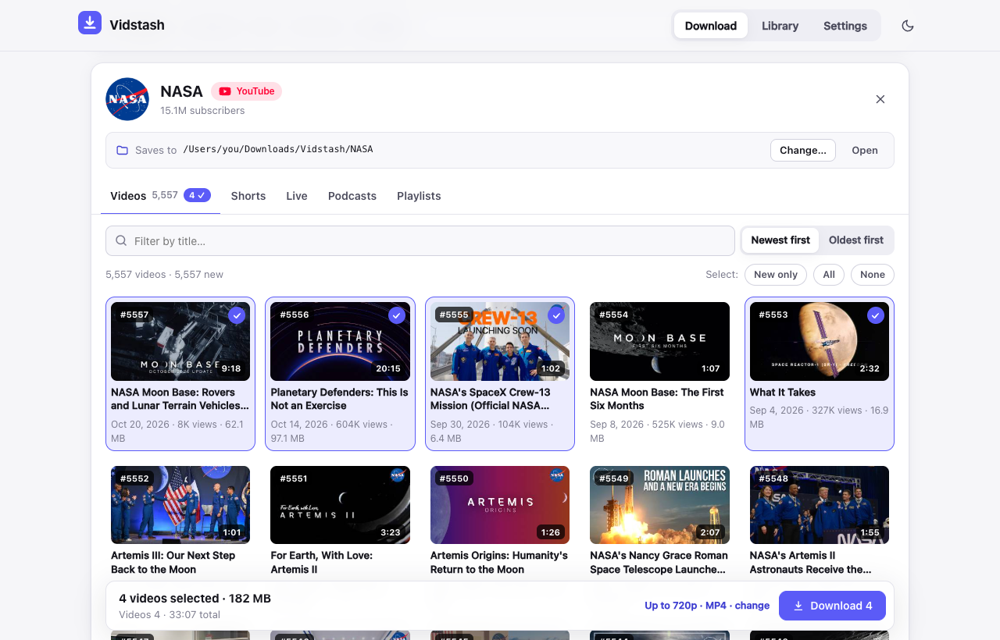
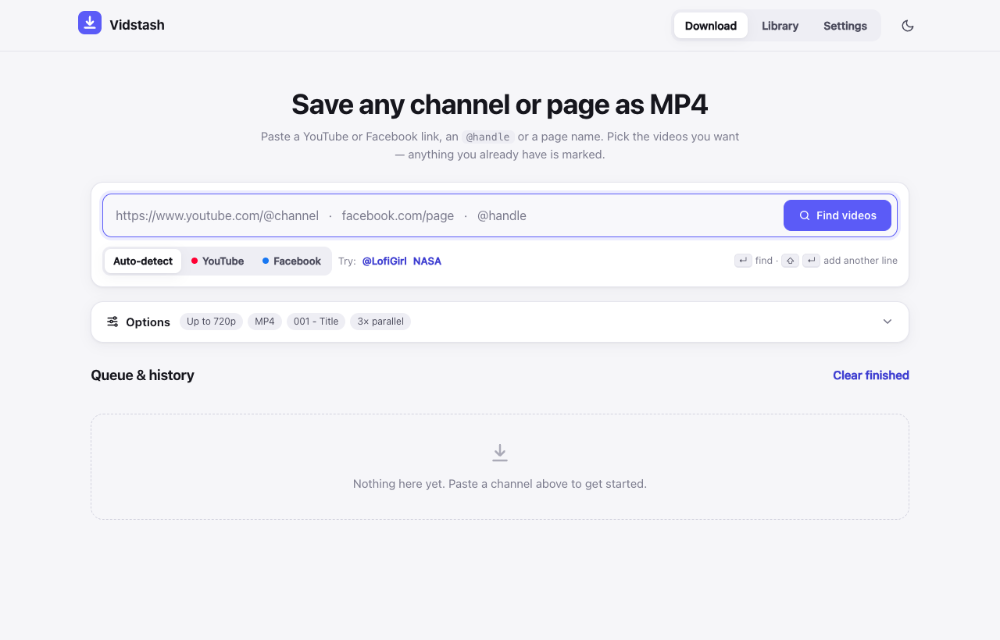
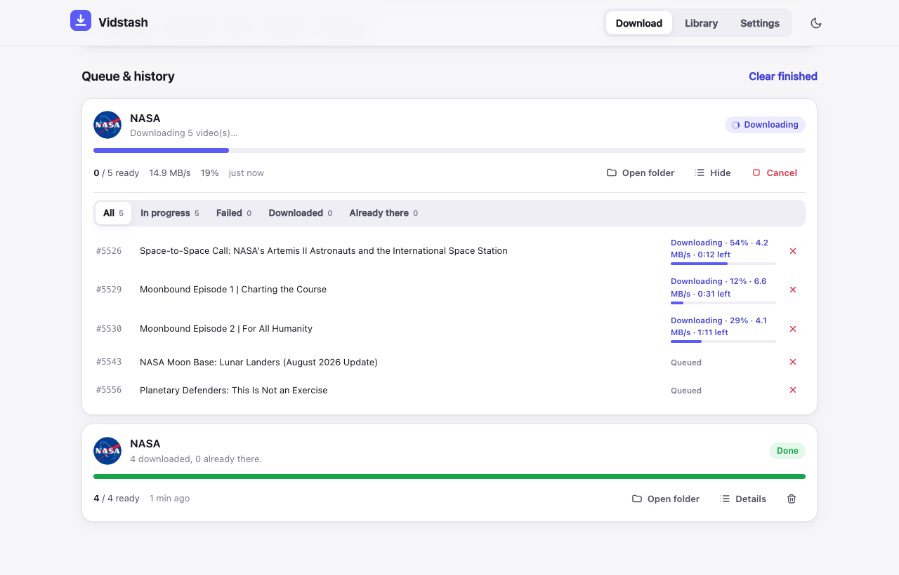
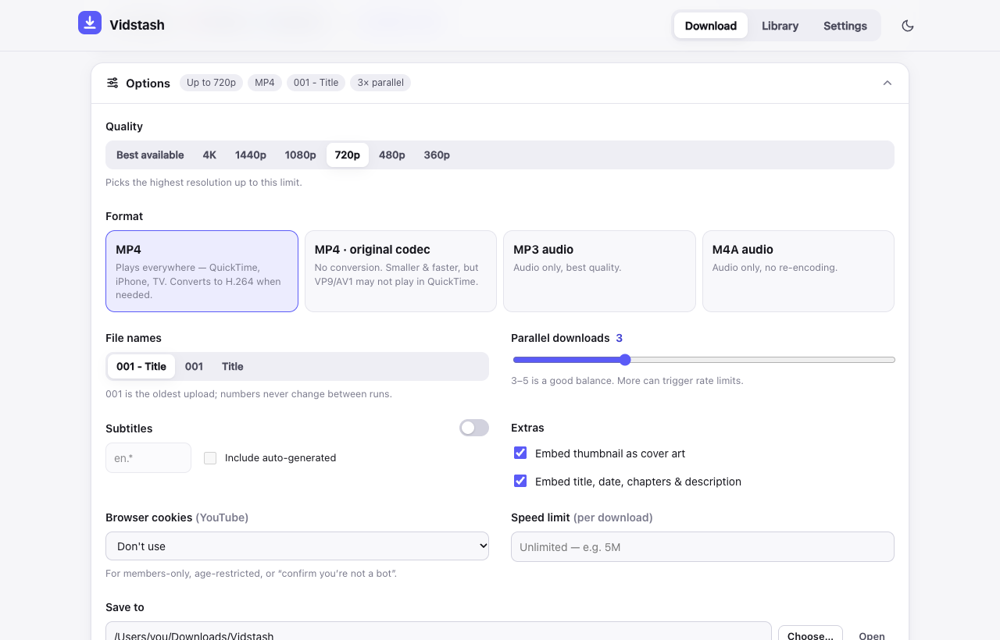
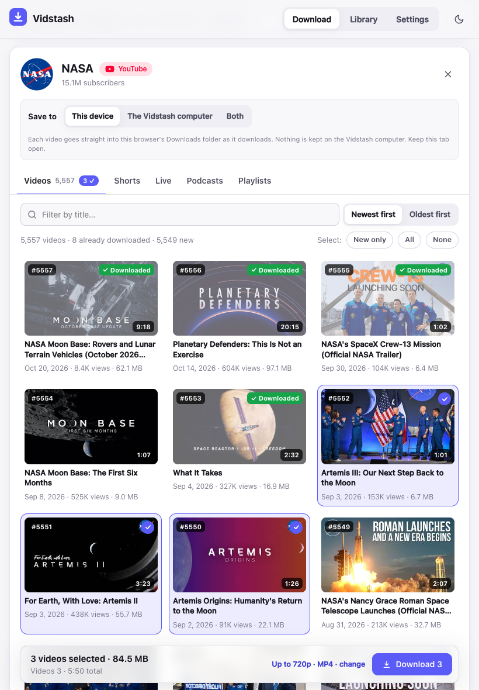
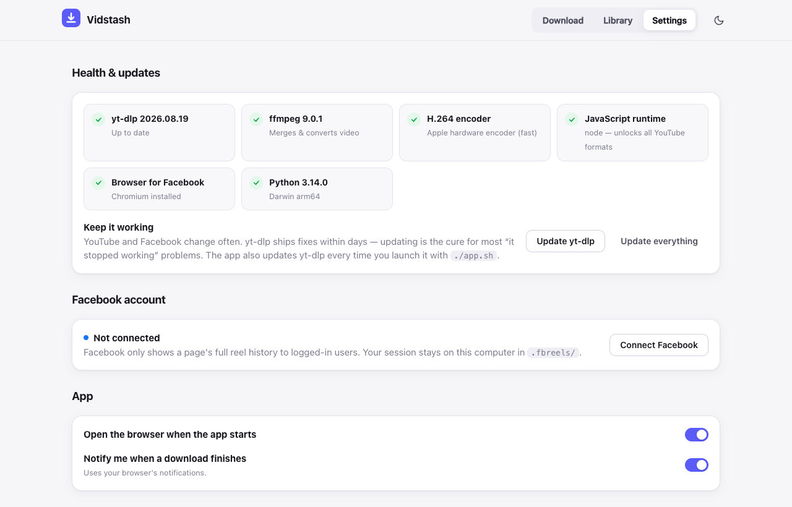

<div align="center">

# 📥 Vidstash

**Save whole YouTube channels and Facebook pages as MP4 videos that play everywhere.**

Paste a link, tick the videos you want, press Download. That's it.



</div>

## Why Vidstash?

- 🔗 **Paste anything:** a channel, a playlist, a single video, an `@handle`, or just a name like `NASA`.
- 👀 **See before you download:** every video with its thumbnail, publish date, views, length and size.
- ✅ **Never download twice:** videos you already have are marked **✓ Downloaded**. Run it again later and only new uploads are fetched.
- 🗂️ **Neatly organised:** each channel gets its own folder, with files named `001 - Title.mp4`, `002 - Title.mp4`… in upload order.
- 🎬 **Best quality that plays anywhere:** up to 4K, as a standard MP4 that works on iPhone, iPad, Android, TVs, Mac and Windows. Audio only (MP3 / M4A) too.
- 📱 **Use it from your tablet or phone:** open it on any device at home, and videos download straight to that device.
- 🔒 **Private:** it runs on your own computer. Nothing goes through anyone else's server.

---

## Install (one time, about 5 minutes)

Vidstash runs on a **Mac**. You only do this once.

**1. Install Homebrew**, the free tool that installs everything else. Open **Terminal** (press `⌘ Space` and type *Terminal*), paste this line and press Enter:

```bash
/bin/bash -c "$(curl -fsSL https://raw.githubusercontent.com/Homebrew/install/HEAD/install.sh)"
```

**2. Install what Vidstash needs** with this line in the same Terminal window:

```bash
brew install python ffmpeg node
```

**3. Download Vidstash.** Click **[Download ZIP](https://github.com/hossameldinmohamed/VideoDownloader/archive/refs/heads/main.zip)**, then double-click the ZIP in your Downloads folder to unpack it. Move the folder wherever you like.

**4. Start it.** Open the folder and double-click **Start Vidstash.command**.

> **macOS says it "can't be opened"?** Right-click the file, choose **Open**, then **Open** again. On newer macOS versions, open **System Settings → Privacy & Security** instead, scroll down and click **Open Anyway**. You only need to do this once.

The first start takes a few minutes while it sets itself up. Then your browser opens Vidstash at **http://127.0.0.1:8787**.

From now on, just double-click **Start Vidstash.command** whenever you want to use it. To stop it, close the Terminal window that opened with it.

---

## How to use it

### 1. Paste a link and press Enter

Paste a YouTube or Facebook link, an `@handle` or a channel name, then press **Enter** or **Find videos**. Not sure what to paste? Click one of the **Try:** examples.



### 2. Tick the videos you want

The channel opens with its **Videos, Shorts, Live, Playlists** and other tabs. Each video shows its publish date, views, length and size.

- New videos are ticked for you. Use **Select: New only / All / None** to change that.
- Videos you already have show **✓ Downloaded** and aren't ticked.
- Type in **Filter by title** to find something, or switch between **Newest first** and **Oldest first**.
- The bar at the bottom shows how many videos you picked and how big they are. Press **Download**.

> **Tip:** paste several links, one per line, to download several channels at once.

### 3. Watch it download

**Queue & history** shows each video's progress, speed and time left.

- **✕** next to a video cancels just that one. The others keep going.
- **Cancel** stops the whole download. **Resume** or **Retry** picks up only what's left or what failed.
- **Open folder** shows the finished files.



### 4. Change quality, format and more (optional)

Open **Options** to choose quality (up to 4K), MP4 or audio only, how files are named, subtitles and where to save. Your choices are remembered.



---

## Download to your tablet or phone

Keep Vidstash running on your Mac, and use it from any tablet or phone on the same Wi-Fi.

**1. Start it so other devices can reach it.** Close Vidstash if it's running. In Terminal, type `cd ` (with a space), drag the Vidstash folder onto the Terminal window, and press Enter. Then run:

```bash
./app.sh --host 0.0.0.0
```

**2. Find your Mac's address:** run `ipconfig getifaddr en0` in Terminal. You'll get something like `192.168.0.102`.

**3. On your tablet,** open the browser and go to `http://192.168.0.102:8787`, using your Mac's address.

**4. Choose where videos go** with **Save to**, right above the video list:

| Choice | What happens |
|---|---|
| **This device** *(default)* | Videos go straight to your tablet as they download. Nothing is kept on the Mac. |
| **The Vidstash computer** | Videos are saved only on the Mac. |
| **Both** | Saved on the Mac, and copied to your tablet too. |

<p align="center"></p>

Good to know:

- With **This device**, videos go to your tablet's normal **Downloads** folder. An iPad may ask you to confirm each one.
- Keep the Vidstash tab open until the downloads finish. If you close it, the download pauses, and **Resume** continues later.
- With **This device**, MP4 videos come in up to 1080p, because they can't be converted on the way. For 4K, choose **The Vidstash computer**.
- Anyone on your Wi-Fi can open Vidstash while it runs this way, so only do this on a network you trust.

<details>
<summary><b>Use it away from home (with Tailscale)</b></summary>

[Tailscale](https://tailscale.com) is free and connects your own devices privately, from anywhere.

1. Install Tailscale on your Mac and on your tablet or phone, and sign in on both.
2. On the Mac, run:
   ```bash
   tailscale serve --bg 8787
   ./app.sh --no-browser --allow-host <computer-name>.<tailnet>.ts.net
   ```
3. On your device, open `https://<computer-name>.<tailnet>.ts.net`.

Over this secure address, Chrome and Edge let you pick a folder on the device for your videos (choose a folder *inside* Downloads, such as a new `Vidstash` folder) and keep the channel folders.

</details>

---

## Facebook pages

Facebook only shows a page's full list of reels to people who are logged in. The first time you download a Facebook page, or when you click **Settings → Connect Facebook**, a browser window opens so you can log in once. Your login stays on your Mac, in the `.fbreels` folder, and is never sent anywhere else.

---

## If something goes wrong



| Problem | What to do |
|---|---|
| A video fails, or "it stopped working" | Go to **Settings → Update yt-dlp**. YouTube and Facebook change often, and updating fixes most problems. Vidstash also updates itself each time you start it. |
| "Sign in to confirm you're not a bot", or members-only and age-restricted videos | In **Options → Browser cookies**, pick the browser where you're logged in to YouTube. |
| The tablet can't open the address | Make sure both are on the same Wi-Fi, and that you started Vidstash with `./app.sh --host 0.0.0.0`. Your Mac's address can change, so check it again with `ipconfig getifaddr en0`. |
| Some quality options are missing | Check **Settings**. Every item should have a green tick. A missing *JavaScript runtime* is fixed with `brew install node`. |

---

## Please download responsibly

Only download videos you have the right to: your own channels and pages, or with the owner's permission. Respect YouTube's and Facebook's terms of service and copyright law.

---

<details>
<summary><b>Terminal usage</b></summary>

Everything also works from the terminal:

```bash
./fbreels.sh "https://www.youtube.com/@channel"
./fbreels.sh "@channel" -q 1080 -n 20             # newest 20, max 1080p
./fbreels.sh "@channel" --tabs videos,shorts
./fbreels.sh "https://www.youtube.com/playlist?list=PL..." -f mp3
./fbreels.sh "https://www.facebook.com/somepage"
./fbreels.sh somename --platform facebook
./fbreels.sh -h                                   # all options
```

Always wrap links in quotes, because `?` and `&` mean something to your shell.

Start options for the app: `./app.sh --no-update` skips the yt-dlp update check, `--port 9000` uses another port, and `--no-browser` doesn't open the browser.

</details>

<details>
<summary><b>For developers</b></summary>

```bash
git clone https://github.com/hossameldinmohamed/VideoDownloader.git && cd VideoDownloader
./app.sh                           # first run sets up .venv, yt-dlp, Chromium and ffmpeg
source .venv/bin/activate
pip install -r requirements-dev.txt
pytest -q                          # unit + API tests
LIVE=1 pytest tests/test_live.py   # real YouTube download
ruff check fbreels tests
python -m fbreels.web --port 8787  # run the server directly
```

| Path | What's there |
|---|---|
| `fbreels/resolver.py` | Turns links, handles and names into a target |
| `fbreels/engine.py` | Scanning, numbering, yt-dlp options, MP4 conversion, parallel downloads, streaming to a device |
| `fbreels/scraper.py` | Facebook Reels scanning with Playwright |
| `fbreels/jobs.py` | Background job queue, history, cancel and retry |
| `fbreels/web.py` | FastAPI server and API |
| `fbreels/static/` | The web UI (plain HTML/CSS/JS, no build step) |
| `fbreels/cli.py` | Terminal interface |

**Security:** by default the server listens on `127.0.0.1` only. It rejects requests addressed to any other host name, which blocks DNS rebinding, and every write request needs a custom header, which blocks other websites from triggering downloads. `--host 0.0.0.0` turns the host check off so other devices on your network can connect.

**Keeping current:** the workflows in `.github/` keep the project up to date. Dependabot opens daily pull requests for Python dependencies (so yt-dlp fixes arrive fast) and weekly ones for Actions. CI runs lint, tests and a startup check on Linux and macOS. Dependabot pull requests auto-merge once CI passes, except major version bumps. A daily canary installs the newest release of everything, runs a real YouTube download, and opens an issue if something broke. To enable auto-merge: **Settings → General → Allow auto-merge**, plus a branch protection rule on `main` that requires the CI checks.

**Why not host it online (e.g. Vercel)?** Serverless functions time out after minutes, have no ffmpeg or disk, and can't open the Facebook login window. And YouTube blocks downloads from cloud-server IP addresses. Vidstash runs on your own machine, where downloads are fast, private, and don't get blocked.

</details>
